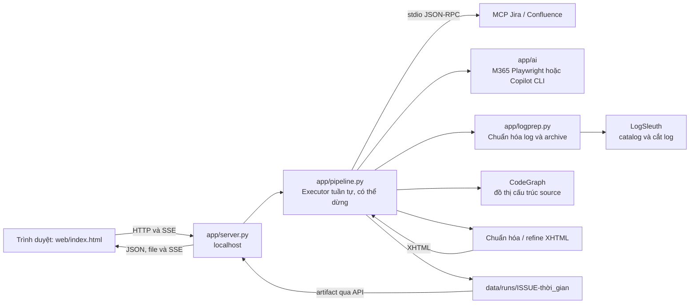

# Tổng quan hệ thống Ticket Analyzer

## Mục tiêu

Ticket Analyzer là ứng dụng web chạy cục bộ để gom dữ liệu từ Jira, log và source code; dùng AI tạo phân tích kỹ thuật; chuyển phân tích thành báo cáo Confluence Storage XHTML; sau khi người dùng duyệt thì đăng/cập nhật trang trên Collab. Ứng dụng hợp nhất Jira/M365, LogSleuth và CodeGraph thành một quy trình có artifact và lịch sử riêng cho từng lần chạy.

## Kiến trúc

- **Giao diện và API:** giao diện tĩnh nằm ở [web/index.html](../web/index.html). [app/server.py](../app/server.py) dùng `ThreadingHTTPServer` của Python, chỉ bind `127.0.0.1`; cập nhật trạng thái/log qua Server-Sent Events.
- **Điều phối:** [app/pipeline.py](../app/pipeline.py) quản lý trạng thái từng bước, điều kiện chạy, hủy tác vụ, artifact và yêu cầu duyệt trước khi publish. Hiện chỉ có một `Executor` chạy tại một thời điểm vì worker M365 dùng chung một phiên trình duyệt.
- **Tích hợp:** [app/mcp.py](../app/mcp.py) gọi Jira/Confluence qua MCP stdio; [app/ai/__init__.py](../app/ai/__init__.py) điều phối hai backend: M365 Copilot được điều khiển bằng Playwright hoặc GitHub Copilot CLI.
- **Dữ liệu:** mỗi lần chạy lưu trong `data/runs/<ISSUE>-<timestamp>/`, gồm file kết quả đánh số bước, `run.json` (trạng thái/đầu vào), và `run.log`. Cấu hình thường ở `data/config/settings.json`; token MCP ở `data/config/mcp.json`.

## Luồng xử lý

| Bước | Tác vụ | Điều kiện | Kết quả / vai trò |
|---|---|---|---|
| 1. Jira | Lấy ticket và attachment metadata qua MCP | Luôn chạy | `01-jira.md`, JSON thô, `01-attachments.md` (bảng cho AI chọn) |
| 2. Hiểu ticket | AI trích giờ sự cố *như ticket viết*, múi giờ ticket nêu, ngày, và chọn attachment đáng tải | Có thể có log; trừ chế độ Manual | `02-understanding.md`, `02-focus.json` (schema 2); không đọc log hay source |
| 3. Log brief | Lấy log (tải attachment theo chế độ xử lý), căn khung giờ sang đồng hồ của log, rồi LogSleuth lọc tín hiệu, gom ngữ cảnh, giảm lặp, giới hạn dung lượng | Có log (file chọn tay hoặc attachment) | `03-log-brief.md`, `03-log-span.md` (khoảng giờ từng file + căn múi giờ), `03-catalog.md` khi có source; không source thì seed bằng từ khóa ticket + tín hiệu lỗi |
| 4. Code graph | Đồ thị cấu trúc Python/C/C++/Java/Kotlin/JS/TS; bản cho AI xếp symbol liên quan ticket lên đầu | Có source và bật Code Graph | HTML tương tác, `04-graph.simple.json` (focus theo ticket), report |
| 5. Phân tích | AI tổng hợp ticket và các artifact của bước đã thành công | Luôn chạy | `05-analysis.md`; kèm `05-source-evidence.md` quanh các `file:line` LogSleuth match |
| 6. Định dạng | AI đổi phân tích thành Confluence Storage XHTML; sửa cục bộ trước, chỉ refine bằng AI nếu còn lỗi | Luôn chạy | `06-report.xhtml`, preview, phản hồi thô, log refine |
| 7. Infographic | M365 tạo ảnh, lỗi thì fallback SVG cục bộ; Copilot CLI luôn dựng SVG từ JSON | Khi bật; lỗi không chặn publish | `06-infographic.*` |
| 8. Publish | Tạo trang hoặc cập nhật trang trùng tiêu đề; đính ảnh nếu có, thiếu ảnh vẫn đăng và ghi chú | Sau duyệt (hoặc tự động nếu bật) | `07-collab.json` và URL trang |

### Chế độ xử lý (evidence gate)

Mỗi run có `gate`: **skip** (AI tự quyết trong giới hạn tải `auto_download_max_mb`, bước hỏng bị bỏ
qua, chạy đến cuối), **review** (dừng ở bước Log với đề xuất của AI điền sẵn, người dùng xác nhận qua
`POST /api/runs/<id>/gate`), **manual** (bước 2 không chạy; người dùng tự nhập tệp, khung giờ, lệch
giờ). Tải attachment lỗi: skip ghi log rồi chạy tiếp không log; review/manual quay lại hỏi.

### Căn múi giờ ([app/evidence/timealign.py](../app/evidence/timealign.py))

Khung giờ bước 2 là "giờ ticket". Trước khi cắt log, app lấy first/last timestamp từng file
(LogSleuth `span`, có đánh dấu file vắt qua nửa đêm) và thử các phương án giải thích được: cùng
đồng hồ; log UTC + múi giờ ticket nêu; log UTC + múi giờ của chính timestamp Jira. Lệch đặt tay luôn
thắng; đúng một phương án rơi vào khoảng log thì dùng; còn mơ hồ thì AI phá hoà theo `log-time.md`
(câu trả lời bị từ chối nếu cửa sổ dịch xong vẫn ngoài log). Mọi bằng chứng và lựa chọn nằm trong
`03-log-span.md`. Cửa sổ rỗng vẫn fallback quét toàn bộ log như trước.

### Token theo lượt chạy

Mỗi lần bấm Chạy mở một bản ghi trong `usage_passes` (từ bước nào, bao nhiêu token, bao lâu, theo
từng bước); chạy lại cộng lượt mới. Copilot CLI đo thật qua usage events; M365 ước lượng byte/4 và
đánh dấu `estimated`. `usage_total` cộng mọi lượt.

### Hai đường xử lý log

LogSleuth có hai chế độ: **Auto** dùng log/source đã chọn ở giao diện chính, tự scan và slice theo
timestamp chuẩn hóa của bước 2 với cấu hình mặc định. **Manual** dừng pipeline để thao tác Scan →
chọn catalog/service → chọn khung giờ/tuning → Slice; người dùng xem brief rồi bấm Proceed để chạy
tiếp. Thiếu/sai timestamp trong Auto thì dùng toàn catalog trên toàn khoảng log.
Toàn bộ Markdown đầu ra có cap bảo thủ 2.000–50.000 token, tính cả heading/bảng theo byte UTF-8;
ngân sách per-run không vượt Settings. Chi tiết: [docs/logsleuth-integration.md](logsleuth-integration.md).

1. Có source folder: [app/evidence/logsleuth.py](../app/evidence/logsleuth.py) gọi [logsleuth/cli.js](../logsleuth/cli.js) để quét template log trong source, rồi khớp các anchor với log runtime. [app/logprep.py](../app/logprep.py) hỗ trợ archive lồng nhau, nén, encoding phổ biến, JSON array và DLT.
2. Không có source folder: LogSleuth vẫn tạo brief bằng từ khóa ticket và các tín hiệu như error/failure/timeout/crash. Kết quả có thể hữu ích để khoanh vùng nhưng không cung cấp liên kết `file:line` từ source.

### Diễn giải bằng chứng

- LogSleuth chứng minh một template/log pattern xuất hiện trong log; riêng việc khớp log không chứng minh nguyên nhân.
- CodeGraph là chỉ mục cấu trúc, không phải call trace hay bằng chứng hành vi runtime. Bước phân tích chỉ nên khẳng định hành vi khi có đoạn source evidence hoặc log/ticket hỗ trợ.
- Cửa sổ thời gian hiện dùng giờ trong ngày; ticket không nêu giờ thì pipeline không lọc theo thời gian. Nếu lọc ra 0 dòng, bước log thử lại trên toàn bộ khoảng log.

## Cấu hình và vận hành

- Chọn backend AI, model, ngôn ngữ, thư mục tải attachment, ngân sách LogSleuth/CodeGraph và Collab space qua UI/cấu hình.
- Tùy chọn ở dưới Jira cho phép tiếp tục sau lỗi ở bước 2–4; step lỗi vẫn được ghi nhận, và AI chỉ nhận evidence từ các step thành công. Lỗi ở bước bắt buộc vẫn dừng pipeline.
- Ứng dụng kiểm tra phiên đăng nhập M365 một lần ở nền khi khởi động nếu Playwright/Chromium sẵn sàng; trạng thái này là tuỳ chọn khi đang dùng Copilot CLI.
- Attachment được tải có chọn lọc; archive được giải nén với kiểm tra path traversal và giới hạn dung lượng.
- Copilot CLI chạy trong thư mục artifact của run, không bật shell/write tool và tắt MCP tích hợp sẵn. Token không được gửi xuống trình duyệt.
- Báo cáo preview được xử lý cục bộ; PlantUML không được gửi tới renderer bên ngoài.
- [README.md](../README.md) mô tả cách cài, chạy, đóng gói và sử dụng.

## Các ưu tiên để nâng chất lượng pipeline

1. **Độ mới của cache:** catalog và CodeGraph hiện lưu fingerprint metadata source (đường dẫn tương đối, kích thước, `mtime_ns`); graph thu gọn cũng được tạo lại khi ngân sách token đổi. Nếu cần bắt cả trường hợp nội dung đổi nhưng kích thước/mtime bị giữ nguyên, có thể nâng cấp manifest sang content hash hoặc watcher.
2. **Dependency và trạng thái stale:** khi chạy lại từ một bước giữa, pipeline hiện tự lùi để chạy lại prerequisite stale và chỉ truyền artifact đã `done` cho bước phân tích. Về lâu dài nên khai báo dependency thành DAG thay vì dựa vào thứ tự tuyến tính của các bước.
3. **Ngân sách ngữ cảnh tổng:** log brief và graph có ngân sách riêng; nên áp ngân sách cho tổng ticket + log + graph + source excerpt trước khi gửi AI để giảm lỗi vượt context và chi phí.
4. **Khả năng phục hồi:** bổ sung retry/backoff có giới hạn cho lỗi tạm thời ở AI/MCP, phân biệt lỗi có thể retry với publish không an toàn, và lưu metadata về model/prompt/input fingerprint cho từng bước.
5. **Thời gian log:** nếu log có nhiều ngày hoặc nhiều múi giờ, hỗ trợ ngày/offset sẽ chính xác hơn chỉ lọc theo giờ trong ngày.

Pipeline hiện đã có fallback log khi thiếu source, refresh cache theo fingerprint metadata và chạy lại prerequisite stale. Ưu tiên tiếp theo: ngân sách context tổng và retry/backoff an toàn; sau đó khai báo DAG rõ hơn, hỗ trợ ngày/múi giờ cho log và tối ưu thời gian chạy/UI.
